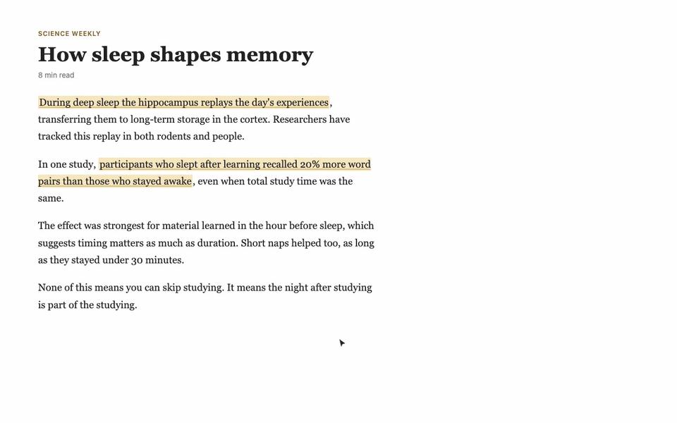
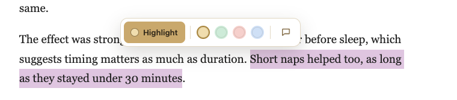
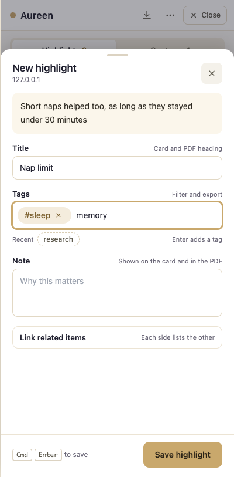
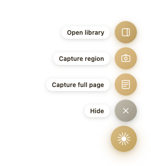
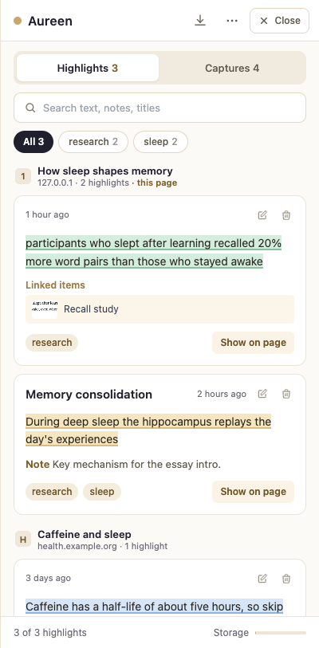
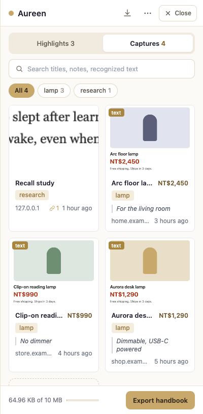
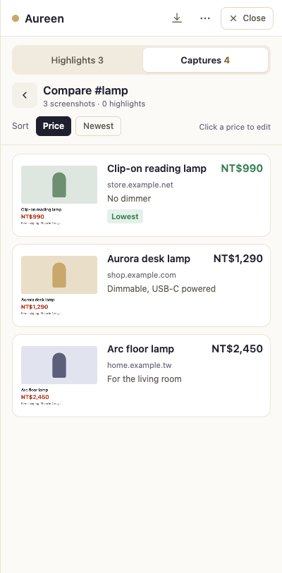

# Aureen

[English](README.md) | [繁體中文](README.zh-TW.md)

Highlight text and screenshot anything on a web page, tag it, find it again later, and compare prices across shops. A Chrome extension. Everything stays on your machine.



## Why

I built Aureen for myself. Four things kept going wrong:

- I read with a dozen tabs open and copy passages into a notes app. A week later I have the text, but not the page it came from or the reason I saved it.
- Some sites block text selection (e-book readers, previews). A screenshot is the only way to keep the passage, and a folder of screenshots cannot be searched.
- Comparing the same product across three shops meant three tabs and a spreadsheet in my head.
- I type Chinese with Zhuyin. In most tag fields I tried, pressing Enter to pick a character also submitted the form.

Aureen is the smallest tool I could make that fixes those four, without an account and without sending anything to a server.

## What it does

- **Highlight.** Select text and pick a color in the toolbar. Highlights are marked again when you come back to the page. If the page changed, Aureen finds the passage by its text.
- **Capture.** Screenshot a region, or a full page that stops where the article ends, then trim the top and bottom.
- **Read screenshots.** Recognize text in a screenshot offline (Traditional Chinese and English), copy it, and search by it.
- **Tag and find.** Search everything, filter by tag, and see highlights grouped by page with the page you are on first. Enter only adds a tag; it never saves the form.
- **Compare.** Pick a tag and see its screenshots side by side, cheapest first. Prices are read from the screenshot text and can be corrected.
- **Link.** Connect a highlight to a screenshot (a spec and a product photo, say) and jump between them.
- **Export.** A PDF handbook for screenshots or highlights, plus JSON and Markdown for highlights.
- **Two languages.** The interface follows your browser (English or Traditional Chinese) and can be switched in the menu.

| Selection toolbar | New highlight | Floating menu |
|---|---|---|
|  |  |  |

| Highlights | Captures | Compare by price |
|---|---|---|
|  |  |  |

## Install

Aureen is not on the Chrome Web Store yet. To run it from source:

```bash
git clone https://github.com/rrspw-oo/aureen-extension.git
cd aureen-extension
npm install
npm run build
```

Then open `chrome://extensions`, turn on Developer mode, click **Load unpacked**, and pick the `dist` folder.

## Use

- Click the toolbar icon to show the floating button; click it again to hide everything. `Alt+S` opens the sidebar.
- Select text to get the highlight toolbar. A color dot highlights in that color and becomes the default. The note button highlights and jumps to the note field.
- In a form, Enter (or `,` `，` `、`) turns what you typed into a tag. Save with the button or `Cmd/Ctrl+Enter`. `Esc` discards.
- **Capture full page** shows a bar at the top: scroll to where the capture should stop and click **Capture to here**.
- In **Captures**, select a tag and click **Compare**. Click a price to fix it; a price you type always wins over a recognized one.
- **Close** in the sidebar header (or `Esc`) folds it back into the floating button.

## How it works

Aureen is a Manifest V3 extension with four parts, split by where the code runs:

```
src/
  background/   service worker: screenshots, stitching, message routing, offscreen OCR
  offscreen/    hidden extension page that runs Tesseract for text recognition
  page/         content script injected into every page: highlighter, toolbar,
                floating button, region and full-page capture
  sidebar/      React app in a Shadow DOM inside the page
    highlights/ highlights list, cards and form
    captures/   screenshot grid, form, trim and compare
    ui/         small shared components (sheet, tag input, search, link picker)
  lib/          storage, export, OCR client, price parsing, DOM helpers
  i18n/         English and Traditional Chinese strings
  types/        data shapes for highlights and screenshots
```

Data lives in `chrome.storage.local`. Highlights are stored with an XPath and character offsets for both ends of the selection, plus the text itself so they can be found again when the page changes. The longer version is in [docs/ARCHITECTURE.md](docs/ARCHITECTURE.md).

## Privacy

No account, no analytics, no network requests. Highlights, screenshots and settings are stored by Chrome on your device. Text recognition runs offline with the Tesseract files bundled in the extension. Details: [PRIVACY_POLICY.md](PRIVACY_POLICY.md).

## Development

```bash
npm run dev                    # Vite dev build with reload
npm run build                  # type-check and production build into dist/
npm run type-check             # TypeScript only
node --test tests/*.test.ts    # unit tests (Node 22.18+ or 23.6+ runs TypeScript directly)
```

The user interface is checked end to end by loading `dist` into the system Chrome with Playwright and driving real pages. The scripts and their fixture pages are in [tests/e2e](tests/e2e/README.md); run one with `node tests/e2e/interface.test.mjs` after a build.

## Limitations

- Chrome only.
- Storage is Chrome's local quota of 10 MB. Full-page screenshots are large and fill it quickly.
- If the same passage appears twice on a page and the page layout has changed, the highlight is placed on the first match.
- Text recognition covers Traditional Chinese and English, and the bundled models add about 15 MB to the extension.
- Price reading takes the first amount next to a currency sign (NT$, $, 元 and others). Check it when a page shows an old and a sale price.
- JSON and Markdown export cover highlights only. Screenshots export as a PDF handbook.

## License

MIT
