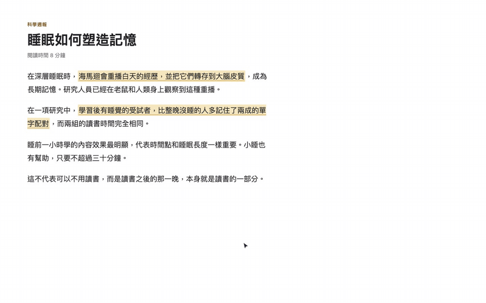
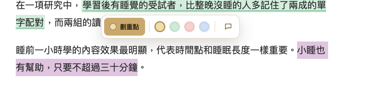
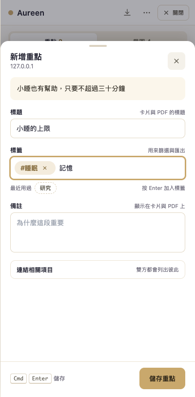
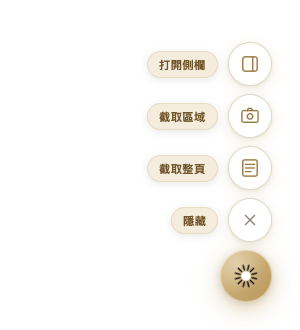
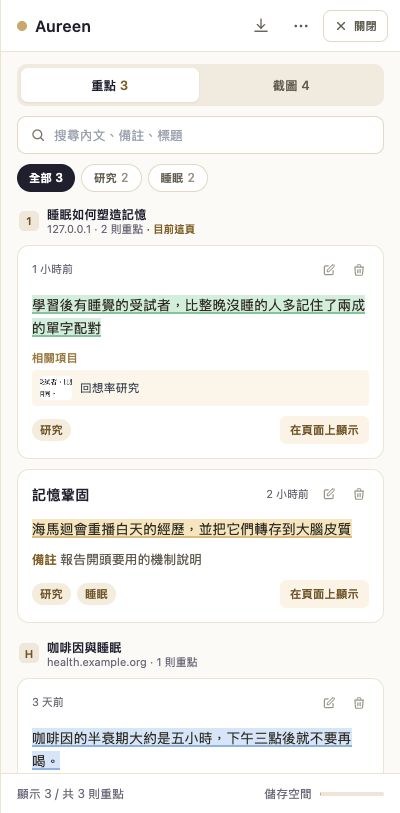
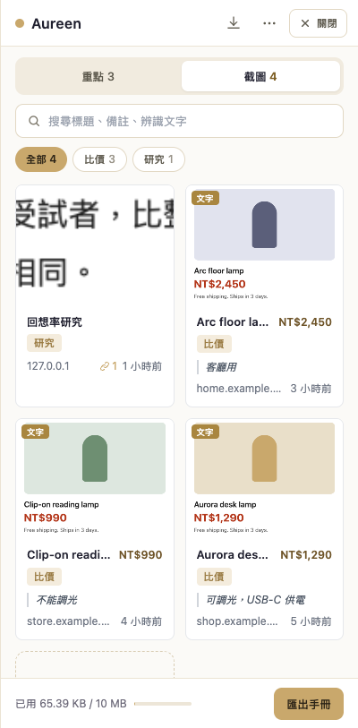
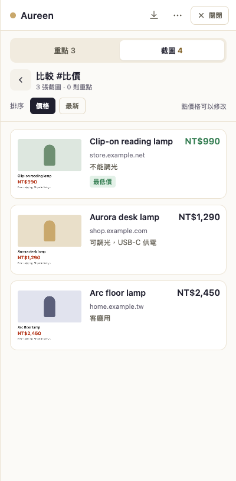

# Aureen

[English](README.md) | [繁體中文](README.zh-TW.md)

在網頁上劃重點、截圖，貼上標籤，之後找得回來，還能把不同網站的商品並排比價。這是一個 Chrome 擴充功能，所有資料都只存在你自己的電腦裡。



## 為什麼做這個

Aureen 是我做給自己用的。以前一直卡在四件事：

- 我讀東西時會開十幾個分頁，把段落複製到筆記軟體。過一個禮拜，文字還在，但已經不知道是從哪一頁來的，也忘了當初為什麼要存。
- 有些網站不能選取文字（電子書閱讀器、試閱頁面）。只能截圖保存，但一整個資料夾的截圖根本沒辦法搜尋。
- 同一個商品要在三家網站比價，就得開三個分頁，在腦中自己記價格。
- 我用注音輸入法打字。試過的工具裡，大多數的標籤欄在我按 Enter 選字時，會順便把表單送出去。

Aureen 是我能做出最小、但能解決這四件事的工具。不用註冊帳號，也不會把任何資料傳到伺服器。

## 功能

- **劃重點。** 選取文字，在工具列選一個顏色。下次回到同一頁，重點會自動標回去；如果網頁改版了，Aureen 會用文字內容把那段找回來。
- **截圖。** 截取一個區域，或截取整頁並在文章結束處停下來，再把頭尾多餘的部分裁掉。
- **讀懂截圖。** 離線辨識截圖裡的文字（繁體中文與英文），可以複製，也可以用它來搜尋。
- **標籤與搜尋。** 搜尋所有內容、用標籤篩選；重點會依網頁分組，目前這一頁排第一。按 Enter 只會加入標籤，絕對不會送出表單。
- **比價。** 選一個標籤，就能把那些截圖並排比較，最便宜的排第一。價格從截圖文字自動讀出，讀錯可以直接改。
- **連結。** 把一段重點和一張截圖連在一起（例如規格說明和商品照片），可以互相跳轉。
- **匯出。** 截圖和重點都能匯出成 PDF 手冊；重點另外可以匯出 JSON 和 Markdown。
- **雙語介面。** 介面語言跟隨瀏覽器（英文或繁體中文），也可以在選單裡切換。

| 選取文字的工具列 | 新增重點 | 浮動按鈕選單 |
|---|---|---|
|  |  |  |

| 重點 | 截圖 | 依價格比較 |
|---|---|---|
|  |  |  |

## 安裝

Aureen 目前還沒上架 Chrome 線上應用程式商店。從原始碼安裝：

```bash
git clone https://github.com/rrspw-oo/aureen-extension.git
cd aureen-extension
npm install
npm run build
```

接著打開 `chrome://extensions`，開啟右上角的「開發人員模式」，點「載入未封裝項目」，選擇 `dist` 資料夾。

## 使用方式

- 點工具列上的 Aureen 圖示會出現浮動按鈕，再點一次就全部隱藏。`Alt+S` 打開側欄。
- 選取文字會出現劃重點工具列。點顏色就直接用那個顏色劃記，並設為預設顏色；點備註按鈕會劃記後直接跳到備註欄。
- 在表單裡，按 Enter（或輸入 `,` `，` `、`）會把剛打的字變成標籤。用按鈕或 `Cmd/Ctrl+Enter` 儲存，`Esc` 捨棄。
- 「截取整頁」會在畫面上方出現提示列：捲到想停的位置，按「截到這裡」。
- 在「截圖」分頁選一個標籤，按「比較」。點價格可以修改；你自己輸入的價格永遠優先於辨識出來的價格。
- 側欄上方的「關閉」（或 `Esc`）會把側欄收回浮動按鈕。

## 運作方式

Aureen 是 Manifest V3 擴充功能，程式碼依「在哪裡執行」分成四塊：

```
src/
  background/   service worker：截圖、拼接、訊息轉送、開啟離線 OCR
  offscreen/    隱藏的擴充功能頁面，用 Tesseract 辨識文字
  page/         注入每個網頁的 content script：劃重點、工具列、
                浮動按鈕、區域與整頁截圖
  sidebar/      以 Shadow DOM 放進網頁的 React 側欄
    highlights/ 重點清單、卡片與表單
    captures/   截圖格狀清單、表單、裁切與比價
    ui/         共用的小元件（面板、標籤輸入、搜尋、連結選擇）
  lib/          儲存、匯出、OCR 呼叫、價格解析、DOM 工具
  i18n/         英文與繁體中文字串
  types/        重點與截圖的資料結構
```

資料存在 `chrome.storage.local`。每則重點會記下選取範圍兩端的 XPath 與字元位置，以及文字本身，網頁改版時才找得回來。完整說明在 [docs/ARCHITECTURE.zh-TW.md](docs/ARCHITECTURE.zh-TW.md)。

## 隱私

不需要帳號、沒有任何分析追蹤，也不發出任何網路請求。重點、截圖和設定都由 Chrome 存在你的裝置上。文字辨識使用擴充功能內附的 Tesseract 檔案，完全離線。詳細內容見 [PRIVACY_POLICY.zh-TW.md](PRIVACY_POLICY.zh-TW.md)。

## 開發

```bash
npm run dev                    # Vite 開發模式，自動重新載入
npm run build                  # 型別檢查並建置到 dist/
npm run type-check             # 只做 TypeScript 型別檢查
node --test tests/*.test.ts    # 單元測試（Node 22.18+ 或 23.6+ 可直接執行 TypeScript）
```

介面的端對端測試是用 Playwright 把 `dist` 載入系統的 Chrome，在真實網頁上實際操作。腳本和測試用網頁放在 [tests/e2e](tests/e2e/README.md)，建置後執行 `node tests/e2e/interface.test.mjs` 就能跑其中一組。

## 限制

- 只支援 Chrome。
- 儲存空間是 Chrome 的 local 配額 10 MB。整頁截圖檔案很大，很快就會用完。
- 如果同一段文字在頁面上出現兩次，而且網頁版面已經改變，重點會標在第一個符合的位置。
- 文字辨識只支援繁體中文與英文，內附的辨識模型會讓擴充功能多出大約 15 MB。
- 價格是抓「第一個貨幣符號旁邊的數字」（NT$、$、元等）。網頁同時顯示原價和特價時，請確認一下。
- JSON 和 Markdown 只匯出重點；截圖請用 PDF 手冊匯出。

## 授權

MIT
